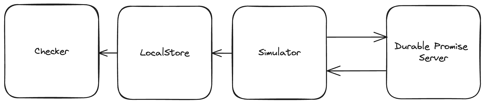
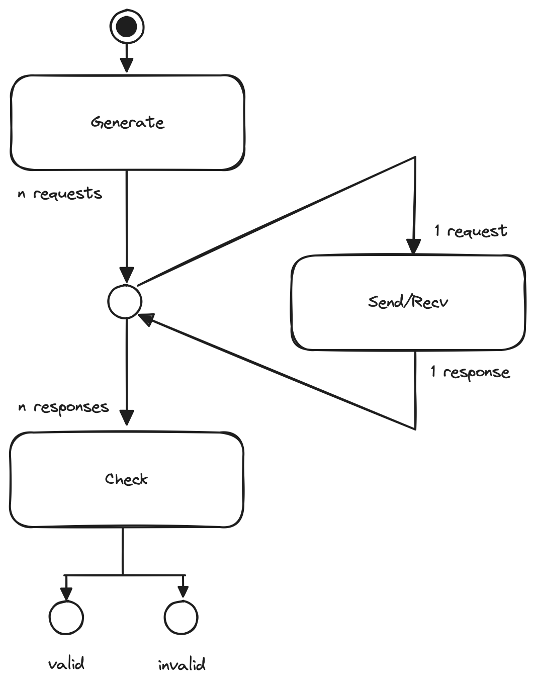

# Legacy Durable Promise Test Harness

> [!WARNING]
> **This repository is archived.** It was the conformance test harness for the legacy REST durable-promise spec, paired with [resonatehq/resonate-legacy-server](https://github.com/resonatehq/resonate-legacy-server) (deprecated as of v0.8.2). The current Resonate server ([resonatehq/resonate](https://github.com/resonatehq/resonate), Rust) uses an RPC envelope contract that this harness does not exercise — see its `diff/` directory for the current differential testing setup. The original durable-promise spec has been folded into the broader [Distributed Async Await Specification](https://github.com/resonatehq/distributed-async-await.io); the [durable-promise-specification](https://github.com/resonatehq/durable-promise-specification) repo is preserved for historical reference.

This test harness is a verification system that checks implementations for conformance to the [Durable Promise Specification](https://github.com/resonatehq/durable-promise-specification).

## Architecture

<p align="center">
    
</p>

The test harness is composed of four key components working together: 

- Checker 
- LocalStore 
- Simulator 
- Durable Promise Server 

### Checker 

The `Checker` validates that the operation history follows the specifications of the [Durable Promise API](https://github.com/resonatehq/durable-promise-specification). It is the final validation step.

### LocalStore 

The `LocalStore` tracks the start and end of each operation in memory. It generates the history of events that the `Checker` uses to verify correctness.

### Simulator 

The `Simulator` generates a simulated client and pseudo-random sequence of operations for testing purposes. It exercises the system under diverse conditions.

### Durable Promise Server

The `Durable Promise Server` implements the core [Durable Promise Specification](https://github.com/resonatehq/durable-promise-specification). It is the system under test.

## Usage 

1. **Build**

   ```bash
   go build -o harness
   ```

2. **Verify**

   ```bash
   ./harness verify -a http://0.0.0.0:8001/ -r 1000 -c 3
   ```

NOTE: the history, analysis, and any supplementary results are written to the filesystem under `test/results/<date>/` for later review.

## Design Decisions 

### Event Loop 

Each event loop generates N operations in a batch per client. Each client executes the operations one by one, storing their results. The checker then checks all of the results in a batch.

<p align="center">
    
</p>

## Contributions

This repository is archived and no longer accepts contributions. See the banner at the top for current testing patterns.

